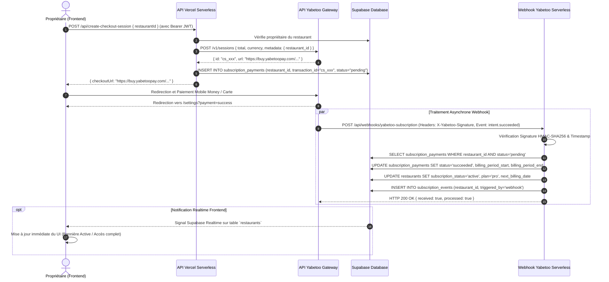

# Architecture du Système de Paiement — Le Bourgeois / restaurant-mvp

## 1. Vue d'Ensemble

Le système de paiement de **Le Bourgeois (restaurant-mvp)** gère deux types de flux de transactions distincts :

1. **Abonnement SaaS B2B (Propriétaire de restaurant)** :
   - Le restaurateur souscrit au plan **PRO** (35 000 XAF/mois, ou 500 XAF en mode test).
   - Les paiements sont traités via **Yabetoo** (`api/create-checkout-session.js`).
   - La confirmation automatique passe par le webhook serveur-à-serveur `api/webhooks/yabetoo-subscription.js` (ou `yabetoo-debug.js`).
   - La mise à jour active le restaurant (`subscription_status = 'active'`, `plan = 'pro'`, `next_billing_date = now() + 1 mois`) et enregistre un audit dans `subscription_events`.

2. **Paiement de Commande Client Final (Commandes à emporter)** :
   - Le client commande en ligne via le menu digital du restaurant.
   - Les paiements sont générés via `api/create-order-payment-session.js` (accès public sans authentification Supabase, montant recalculé côté serveur à partir des éléments enregistrés en base).
   - La confirmation automatique passe par le webhook `api/webhooks/yabetoo-order.js`.
   - La mise à jour passe la ligne de paiement dans `payments` à `succeeded` et fait évoluer la commande dans `orders` vers `paid` ou `in_preparation`.

---

## 2. Diagramme de Séquence — Abonnement SaaS B2B

---

## 3. Sécurité et Idempotence

1. **Vérification Cryptographique HMAC-SHA256** :
   - Chaque webhook Yabetoo est authentifié à l'aide de la clé secrète `YABETOO_WEBHOOK_SECRET`.
   - La signature fournie dans le header `x-yabetoo-webhook-signature` est comparée de manière sécurisée (contre les attaques temporelles via `crypto.timingSafeEqual`) au hash calculé sur le payload brut `${timestamp}.${rawBody}`.
   - Le timestamp est vérifié avec une tolérance de 5 minutes (`WEBHOOK_TOLERANCE_SECONDS = 300`) pour éviter les attaques par rejeu.

2. **Idempotence des Transactions** :
   - La mise à jour du paiement et du statut du restaurant utilise un filtre strict sur `status = 'pending'`.
   - Si Yabetoo renvoie le même webhook plusieurs fois en cas d'essai réseau, la deuxième requête ne modifie aucun enregistrement et renvoie `alreadyProcessed: true` avec un statut `200 OK`.

3. **Protection des Clés d'API** :
   - La clé `SUPABASE_SERVICE_ROLE_KEY` est exclusivement conservée et exécutée dans l'environnement serveur (Vercel Serverless Functions).
   - Les clients web (navigateur) n'y ont jamais accès.

---

## 4. Stratégie de Réconciliation et Fallback Cron

En cas de perte de connexion réseau entre Yabetoo et le serveur Vercel lors de l'envoi du webhook :

- Le job cron horaire `/api/cron/reconcile-payments` (protégé par le secret `CRON_SECRET`) recherche tous les paiements en attente (`status = 'pending'`) créés il y a plus de 15 minutes.
- Le cron peut interroger directement l'API Yabetoo et valider manuellement l'abonnement et le paiement de manière autonome.
